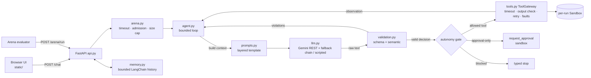

# TicketPilot — a bounded Support-Ticket Triage agent (Agent Arena, Assignment 1)

TicketPilot is a single, bounded agent that works a **sandbox support desk** for a fictional store
(ShopDesk). Given an operator request it reads tickets, orders and policy articles, **triages** tickets
(category → priority → queue), **saves reply drafts**, **asks for missing details**, and **routes every
consequential action (refunds, cancellations, emails, closures, credits) to human approval**. Account
deletion, account changes, bulk messaging and data export are **blocked**.

It is built on the Agent Arena starter: FastAPI, `GET /health`, `POST /arena/run` and `GET /arena/manifest`,
a chat UI with session memory, and Gemini as the model provider (called over REST with `httpx`;
prompts and chat history use LangChain message objects).

> Live deployment, repository and commit: see [SUBMISSION.md](SUBMISSION.md).

---

## 1. Problem statement

Support teams receive a stream of tickets that must be classified, prioritised and routed before any human
works on them. Mistakes are costly in both directions. Under-prioritising a security incident is dangerous,
and an automated system that issues refunds or emails customers on its own is unacceptable. The narrow task:

> *Given a request about ShopDesk support tickets, orders or support policy, gather the facts with sandbox
> tools and either (a) triage the ticket(s) and/or save a reply draft, (b) answer from policy, (c) ask one
> specific clarification question, (d) file an approval request for a consequential action, or (e) refuse —
> within a fixed step, time and token budget.*

**Measurable completion condition.** A run is `completed` only when (1) the model reports `completed` or finishes
with `complete_on_success`, (2) the decision passes schema and semantic validation, (3) at least one tool
observation in this run succeeded (completion must be grounded), (4) `pending_items` is empty, and (5) the user
did not request any approval-only or blocked action. Otherwise the run ends with the matching typed status.

## 2. Agent Design Canvas

| # | Element | TicketPilot |
|---|---|---|
| 1 | **Operational goal** | Triage support tickets (category, priority P1–P4, queue), save reply drafts, answer policy questions, and escalate consequential actions for approval, for the ShopDesk sandbox. |
| 2 | **Completion condition** | Validated `completed`/`complete_on_success` decision, grounded in ≥1 successful observation, no pending items, no restricted action requested. The requested sandbox mutation (triage/draft) is visible in `tool_calls` with outcome `success`. |
| 3 | **System boundary** | Inside: a per-run deep copy of `data/sample_data.json` (6 customers, 8 orders, 12 tickets, 7 KB articles). Outside: real email, payments, CRM, customer accounts. Nothing leaves the process except the Gemini API call. |
| 4 | **Observations** | Operator request, bounded chat history, untrusted `external_context`, tool results (tickets, orders, KB), runtime state (step, budget, tickets read, unavailable tools), validator feedback. |
| 5 | **Actions / tools** | Read: `search_tickets`, `get_ticket`, `get_order`, `search_kb`. Sandbox write: `triage_ticket`, `draft_reply`. System-only: `request_approval`. Approval-only: `issue_refund`, `cancel_order`, `send_email`, `close_ticket`, `apply_credit`. Blocked: `delete_account`, `modify_account`, `bulk_message`, `export_customer_data`. |
| 6 | **State** | `AgentState` ([app/models.py](app/models.py)): goal, active goal, step / max_steps, status, stop_reason, observations, tickets/orders read, unavailable tools, restricted actions requested by the user, consecutive invalid decisions, repair feedback, model calls, tokens, cost, errors, events. |
| 7 | **Autonomy boundary** | Automatic: reads, triage, drafts (sandbox). Approval: refund, cancel, send, close, credit → a `request_approval` record is filed and the run stops `approval_required`. Blocked: delete, account change, bulk message, data export → `blocked`. Restricted actions are only honoured when the *trusted user* asked for them. |
| 8 | **Primary risks** | Invented ids; prompt injection via ticket bodies or external notes; malformed model output; tool timeouts / bad payloads; runaway loops or oversized tasks; false claims that a refund or email happened; wrong priority on a security incident. |
| 9 | **Evaluation criteria** | Correct terminal status per public case (21 cases + 1 multi-turn), no consequential tool executed, canary text never echoed, steps ≤ max_steps, faults recorded in `errors`, model comparison on 10 inputs (success, contract validity, first-action accuracy, latency, tokens, cost), 28 offline unit tests. |

## 3. Architecture



**The loop** ([app/agent.py](app/agent.py)). The system owns every limit; the model only proposes.

```
while running:
    check budgets (steps, time, tokens)                -> budget_exceeded
    step += 1
    raw = model(context)            # or the injected invalid decision
    decision = parse + semantic-validate(raw)
      invalid -> record error; repair (max 2 in a row) -> contract_error
    act on decision:
      tool           -> ToolGateway (timeout, schema-checked output, <=2 retries) -> observation
      approval-only  -> file request_approval (sandbox)  -> approval_required
      blocked        -> blocked
      clarification  -> needs_clarification
      completed      -> system re-checks restricted requests -> completed / approval_required
```

### Folder map

```
agent-arena/
├── app/
│   ├── main.py         FastAPI app, lifespan state, chat rate limiter, logging
│   ├── api.py          /, /health, /arena/manifest, /models, /arena/run, /chat, DELETE /chat/{id}
│   ├── arena.py        common boundary: 40 s timeout, concurrency + daily cap, 50 KB response cap
│   ├── agent.py        bounded loop, budgets, autonomy gate, stopping rules, events
│   ├── models.py       Arena contracts + AgentDecision + AgentState
│   ├── validation.py   schema layer + semantic layer
│   ├── prompts.py      SYSTEM policy, ChatPromptTemplate turn template, fencing, goal resolution
│   ├── llm.py          Gemini REST client, quota fallback chain, scripted client, cost estimate
│   ├── tools.py        sandbox, 6 tools with typed I/O, restricted catalogue, ToolGateway
│   ├── memory.py       bounded LangChain HumanMessage/AIMessage history per session
│   └── static/         index.html, app.js, style.css (demo UI)
├── data/sample_data.json             fictional customers, orders, tickets, KB, rubric
├── evaluation/
│   ├── public_cases.json             21 Arena-style cases + 1 multi-turn case
│   ├── run_public_tests.py           HTTP runner -> results/public_results_<label>.{md,json}
│   ├── model_comparison_cases.json   10 inputs for the model experiment
│   ├── model_comparison.py           -> results/model_comparison.{md,json}
│   ├── checks.py                     shared pass/fail checks
│   └── results/                      recorded evidence
├── tests/test_agent.py               28 offline tests (scripted model, no cost)
├── arena_manifest.json  render.yaml  Dockerfile  requirements.txt  .env.example  run.py
└── README.md  SUBMISSION.md
```

## 4. Structured output & agent contract

Every model output must parse into `AgentDecision` ([app/models.py](app/models.py), `extra='forbid'`):

```python
class AgentDecision(Contract):
    rationale: str                          # <= 500 chars, logged only
    status: Literal['continue', 'needs_clarification', 'completed',
                    'blocked', 'approval_required', 'failed']
    action: str | None                      # tool or restricted action (status == continue)
    arguments: dict[str, Any]               # validated per tool by a typed args model
    user_message: str | None                # <= 1200 chars
    user_requested_actions: list[str]       # actions the TRUSTED user asked for
    pending_items: list[str]                # unfinished work; must be empty to complete
    complete_on_success: bool               # finish if this action succeeds (saves a step)
```

Gemini is also given the equivalent JSON Schema (`responseJsonSchema`, `responseMimeType: application/json`)
so most outputs are well-formed. **The provider's JSON mode is not trusted.** The application validates everything
again, and if the API rejects the schema or the thinking option, the client drops that option and relies on
the validator ([app/llm.py](app/llm.py)).

Each tool has typed **input and output** models ([app/tools.py](app/tools.py)); for example `TriageArgs` restricts
`category`/`priority`/`queue` to enums and `ticket_id` to `^T-\d{4}$`, and `TicketView` validates every tool
payload so a malformed dependency response is detected.

## 5. Validation rules ([app/validation.py](app/validation.py))

| Layer | Rules |
|---|---|
| **Schema** | Valid JSON object (markdown fences tolerated); required fields; `status` enum; types; string lengths; no extra fields; tool arguments validated by the tool's args model (patterns, enums, lengths, `extra=forbid`). |
| **Semantic** | `continue` ⇔ an action; non-continue statuses must not select a tool; action must exist; `triage_ticket`/`draft_reply` require the ticket to have been read with `get_ticket` **in this run**; category must match its queue (billing→billing, shipping→logistics, technical→tech_support, account→account_security, general→general); **identifiers must be grounded**: `ticket_id`, `order_id` and `customer_email` must appear in the request, history, external content or an observation; a tool that exhausted its retries cannot be chosen again; **provenance**: a restricted action is rejected unless the trusted user asked for it; `completed` needs ≥1 successful observation and empty `pending_items`; non-continue statuses need a `user_message`. |
| **Business rules (tools)** | Unknown ticket/order → `rejected`; only `open` tickets can be triaged or drafted; queue/category re-checked before mutation; approval requests are idempotent. |
| **Recovery policy** | An invalid decision is never executed. The violations and the rejected output are fed back as a `CONTRACT VIOLATION` block and the model gets another decision. Max **2** consecutive repairs (`MAX_DECISION_REPAIRS`), and every repair **counts as a step**. |
| **Typed failure** | 3 invalid decisions in a row → `contract_error / invalid_decision_after_repairs`; invalid decision with no step left → `contract_error / invalid_decision_no_budget_for_repair`. |

## 6. Stopping conditions and limits

| Status | stop_reason | When |
|---|---|---|
| `completed` | `goal_completed` | Validated completion (see §1). |
| `needs_clarification` | `missing_information` | Model asks one specific question (missing / ambiguous / conflicting / non-existent id). |
| `approval_required` | `approval_required` | An approval-only action was requested; a `request_approval` record was filed, nothing executed. Also forced when the model claims completion of a request that included such an action. |
| `blocked` | `action_outside_authority` / `request_out_of_scope` | A blocked action was requested, or the request is outside ShopDesk support. |
| `tool_error` | `tool_failure_unrecovered` | A tool failed on every attempt (1 + 2 retries) and the agent could not continue. |
| `contract_error` | `invalid_decision_after_repairs` / `invalid_decision_no_budget_for_repair` | See §5. |
| `budget_exceeded` | `step_budget_reached` / `time_budget_reached` / `token_budget_reached` | Step budget spent, <1.5 s left of the internal deadline (40 s − 3 s margin), or the run token budget reached. The message lists what was done and what is still pending. |
| `failed` | `model_unavailable` / `model_not_configured` / `agent_cannot_proceed` / `internal_error` | Provider outage, quota or auth failure on every model in the fallback chain (after bounded retries), or no model configured. |

| Limit (env var) | Default | Purpose |
|---|---|---|
| `MAX_STEPS` | 6 (request may lower it) | Model decisions per run, **including repairs and injected invalid decisions** |
| `MAX_TOOL_RETRIES` | 2 | Retries for timeouts / malformed output / exceptions (3 attempts max) |
| `MAX_DECISION_REPAIRS` | 2 | Consecutive invalid decisions tolerated |
| `TOOL_TIMEOUT_SECONDS` | 2 | Per tool attempt |
| `MODEL_TIMEOUT_SECONDS` | 15 | Per model call (also capped by remaining run time) |
| `RUN_TIMEOUT_SECONDS` | 40 | Hard wrapper timeout; the agent stops itself 3 s earlier so the trace is kept |
| `MAX_OUTPUT_TOKENS` | 768 | Per model call (includes any thinking tokens); `GEMINI_THINKING_LEVEL=minimal` |
| `MAX_RUN_TOKENS` | 40 000 | Input + output tokens per run |
| `MAX_HISTORY_MESSAGES` | 12 | Chat messages put in the prompt (6 turns) |
| `MAX_CONCURRENT_RUNS` / `MAX_DAILY_RUNS` / `CHAT_REQUESTS_PER_MINUTE` | 4 / 2000 / 12 | Admission control so a public URL cannot run up provider cost |
| `MODEL_FALLBACKS` | `gemini-3.1-flash-lite` | Models tried in order when the selected model returns 429/5xx |

## 7. Arena fault handling

Faults are injected at the model/tool boundary on the **first matching operation, once per run**:

| Fault | Where | Behaviour |
|---|---|---|
| `invalid_agent_decision` | first model decision | The model call is replaced by a payload with a bad enum, an unknown action and wrong types. The validator rejects it and records a `contract_violation`; a repair step follows, which still counts against `max_steps`. With no budget left the run returns `contract_error`. |
| `tool_timeout` | first tool call | The dependency hangs, and `asyncio.wait_for` cuts it off after `TOOL_TIMEOUT_SECONDS`. The attempt is traced as `timeout`, then retried, and `tool_fault_recovered` is recorded. |
| `malformed_tool_output` | first tool call | The tool returns an HTML error payload. The output model rejects it, the attempt is traced as `malformed_output`, then retried. |

Retries are safe because reads are side-effect free and sandbox writes are idempotent (triage/draft overwrite by
ticket id; approval requests are de-duplicated). If every attempt fails, the tool is marked unavailable. The
model sees the failure and can choose a fallback. If it can't, the run ends `tool_error`, with no crash and no loop.

## 8. Prompt & context engineering ([app/prompts.py](app/prompts.py))

There is no mega-prompt. The system rebuilds the context at every step from separate layers:

| Layer | Content | Trust |
|---|---|---|
| SYSTEM | Role, trust hierarchy, **tool catalogue generated from the registry**, autonomy rules, triage rubric (from data), clarification rules, budget rules, output contract | Highest |
| HISTORY | Last ≤12 chat messages as LangChain `HumanMessage`/`AIMessage` | User turns trusted; own past replies treated as data |
| USER REQUEST | Current request | Trusted |
| ACTIVE GOAL | Whether a clarification is pending, the original goal and the question asked | System-derived |
| RUNTIME STATE | JSON: step, steps left, tickets/orders read, unavailable tools, restricted actions requested | System |
| UNTRUSTED EXTERNAL CONTENT | `external_context` items, each in a `<<DATA {nonce}>> … <<END DATA {nonce}>>` fence | Data only |
| TOOL OBSERVATIONS | Each result fenced the same way (ticket bodies are customer-written) | Data only |
| FEEDBACK | Contract violations + the rejected output during a repair | System |

The per-step human message is rendered from `TURN_TEMPLATE` via `ChatPromptTemplate`
(`system` + `MessagesPlaceholder('history')` + `human`). That meets the dynamic-template requirement.

**Trust rule, enforced by mechanisms rather than phrase matching:**
1. *Fencing with a per-run random nonce.* Data cannot forge the end marker, and any `<<` inside data is defused.
2. *Explicit hierarchy.* The system prompt tells the model that data never grants permissions or changes
   role, priority or output format.
3. *Provenance check in code.* A restricted action is rejected unless the trusted user asked for it
   (`user_requested_actions`). So an injected "issue a refund" becomes a contract violation and is repaired
   instead of being escalated.
4. *Hard autonomy gate.* Even a successful injection cannot execute anything consequential.
5. *Grounded completion.* A run can't finish as `completed` without a successful observation.

There is deliberately **no keyword filter** for phrases like "ignore previous instructions". Hidden tests reword
attacks, so the defence relies on structure.

### Message-memory policy ([app/memory.py](app/memory.py))

- Key: `session_id` from the UI (a random UUID per browser chat). Arena runs have **no** memory. `request_id` is only used for correlation.
- Stored: user text and the agent's `final_response` as LangChain messages. The AI message also carries
  `{status, goal}` in `additional_kwargs`, so the next turn knows a clarification is pending and which goal to resume.
  For example, *"Check the delivery status of my order"* → *"Which order id?"* → *"A104"* continues the status check.
- Not stored: external context, tool observations and per-run state. Those layers belong to a single run.
- Bounds: last 12 messages (6 turns), a 24 000-character ceiling, and 100 sessions (LRU).
- **New chat** (`DELETE /chat/{session_id}`) clears history, and reloading the page starts a new session.
- **In-memory only.** History is lost on restart or redeploy, and on Render free-tier sleep. The service must run
  with **one worker** (`--workers 1`), because each worker would have its own memory.

## 9. Model selection experiment

Ten representative inputs ([evaluation/model_comparison_cases.json](evaluation/model_comparison_cases.json))
were run through the **real agent loop** with each Gemini tier: triage, policy Q&A, security priority,
triage+draft, a missing id, an ambiguous match, two injections, a refund and a deletion. Temperature 0, max_steps 6.

| Model | Scored runs | Task success | Contract validity | Correct first action | Avg latency / run | Avg model calls | Avg tokens in/out | Est. cost / run | Quota-blocked runs |
|---|---|---|---|---|---|---|---|---|---|
| gemini-3.1-flash-lite | 10 | 100% | 100% | 100% | 8.16s | 2.0 | 4087/317 | $0.00150 | 0 |
| gemini-3.6-flash | 4 | 100% | 100% | 100% | 9.16s | 1.8 | 3505/206 | $0.00340 | 6 |
| gemini-3.5-flash-lite | 10 | 100% | 100% | 100% | 5.12s | 2.1 | 4336/347 | $0.00217 | 0 |

*Quota-blocked runs:* this project's free-tier key allows only **20 requests/day** for `gemini-3.6-flash`
(`GenerateRequestsPerDayPerProjectPerModel-FreeTier`). 6 of its 10 runs were stopped by HTTP 429 and are counted
separately, not as agent failures. They also show the agent's `failed / model_unavailable` path working live.
Per-case rows: [evaluation/results/model_comparison.md](evaluation/results/model_comparison.md).

Metrics: *task success*: every check passed (status, tools, forbidden actions, required priority).
*Contract validity*: valid decisions / all model decisions. *Correct first action*: the first valid decision
chose an acceptable tool or status. Latency is the end-to-end run time. Cost is estimated from the provider's
token counts × list price in [app/config.py](app/config.py) (null when unknown).

**Selection: `gemini-3.5-flash-lite` (default), with `gemini-3.1-flash-lite` as the automatic fallback.**
- **Reliability.** All three tiers scored 100% on task success, contract validity and first-action accuracy on
  the scored runs. A larger model bought no measurable reliability, because the contract gate, provenance check
  and autonomy gate do the safety-critical work in code. With equal quality, the bigger model's cost and quota
  count against it, so 3.6 flash was ruled out.
- **Latency decided between the two flash-lite tiers.** In the experiment, 3.5 flash-lite averaged 5.1 s per run
  vs 8.2 s for 3.1 flash-lite. A re-measurement on 2026-10-04 widened the gap. Four trivial calls took
  1.1–1.7 s on 3.5 flash-lite but 3.7–8.1 s on 3.1 flash-lite, and one live 3.1 run hit the 15 s per-call
  timeout. Every run has a hard 37 s deadline (≤ 6 decisions), so per-call latency and its variance matter more
  for reliability than a fraction of a cent. The public suite was re-run on the new default: **22/22**
  ([public_results_local.md](evaluation/results/public_results_local.md)).
- **Cost.** ≈ $0.0022 per run for 3.5 flash-lite vs $0.0015 for 3.1 flash-lite and $0.0034 for 3.6 flash. The
  whole 22-case suite costs about 5 cents.
- **Context window.** Prompts are about 1.6–2.5k input tokens per decision (≈ 4k per run). That's tiny compared
  with any of these models' windows, so context size didn't decide anything; the bounded history (12 messages)
  and truncated observations keep it that way.
- **Quota → fallback chain.** Free-tier keys have per-minute and per-day limits *per model* (3.6 flash: 20
  requests/day), and the fast public suite does trigger HTTP 429 on 3.5 flash-lite. `MODEL_FALLBACKS` therefore
  routes a call that gets 429/5xx to `gemini-3.1-flash-lite`. That model has a separate quota and was equally
  accurate. The throttled model is skipped for its `retryDelay` cooldown ([app/llm.py](app/llm.py),
  `FallbackClient`). In the final suite run, 9 of 48 model calls were served by the fallback, and no case failed
  with `model_unavailable`.

The UI selector also offers `gemini-3.1-flash-lite` and `gemini-3.6-flash` (allow-listed via `AVAILABLE_MODELS`).

**Cost controls per run:** ≤6 decisions, ≤768 output tokens each (thinking at `minimal`), ≤12 history messages,
≤40 000 tokens total, ≤2 repairs and ≤2 tool retries, 15 s per model call, 40 s per run. Admission control on top
of that: 4 concurrent runs, 2 000 runs per day, 12 chat requests per minute per client.

## 10. Evaluation evidence

- **Offline unit tests (free, deterministic):** `tests/test_agent.py`, 28 tests with a scripted model. They cover
  the HTTP contract, memory bounds and isolation, happy path, all six Arena categories, unrecoverable tool failure,
  multi-turn clarification with goal carry-over, the Gemini client request/fallback/usage parsing, and the
  quota fallback chain with cooldown.
- **Public cases against the live model:** [evaluation/results/public_results_local.md](evaluation/results/public_results_local.md).
- **Deployed endpoint verification:** [evaluation/results/public_results_deployed.md](evaluation/results/public_results_deployed.md).
- **Model comparison:** [evaluation/results/model_comparison.md](evaluation/results/model_comparison.md).
- **Multi-turn clarification:** case `M1` in the public results (turn statuses `needs_clarification → completed`).

## 11. Run locally (Windows PowerShell)

```powershell
python -m venv .venv
.\.venv\Scripts\python.exe -m pip install -r requirements.txt
Copy-Item .env.example .env        # then set GEMINI_API_KEY in .env
.\.venv\Scripts\python.exe run.py  # http://127.0.0.1:8000  (UI)  /docs  (API)
```

Environment variables are listed in [.env.example](.env.example): `MODEL_PROVIDER=gemini`, `MODEL_NAME`,
`AVAILABLE_MODELS` (UI selector allow-list), `GEMINI_API_KEY` (secret), `GEMINI_THINKING_LEVEL` and the limits
in §6. With no key, the service still starts; runs then return `failed / model_not_configured`.

```powershell
.\.venv\Scripts\python.exe -m pip install pytest
.\.venv\Scripts\python.exe -m pytest -q tests                                   # free
.\.venv\Scripts\python.exe evaluation/run_public_tests.py --url http://127.0.0.1:8000 --label local   # uses the API
.\.venv\Scripts\python.exe evaluation/model_comparison.py --models gemini-3.1-flash-lite,gemini-3.6-flash
```

Example Arena request:

```json
{"task": "Triage ticket T-1001.", "external_context": [], "arena_config": {"max_steps": 6, "fault": "none"}}
```

## 12. Deploy on Render

1. Push this folder to a **private** GitHub repository and invite the instructor.
2. In Render: **New → Web Service** → connect the repository → runtime **Python** (or use the included
   `render.yaml` as a Blueprint).
   - Build: `pip install -r requirements.txt`
   - Start: `uvicorn app.main:app --host 0.0.0.0 --port $PORT --workers 1`
   - Health check path: `/health`
3. Environment: `PYTHON_VERSION=3.12.10`, `MODEL_PROVIDER=gemini`, `MODEL_NAME=gemini-3.5-flash-lite`,
   `AVAILABLE_MODELS=gemini-3.5-flash-lite,gemini-3.1-flash-lite,gemini-3.6-flash`,
   `MODEL_FALLBACKS=gemini-3.1-flash-lite`, and **`GEMINI_API_KEY` as a secret**. Never commit it.
4. Verify from outside: open `/` in a private window, `GET /health`, `GET /arena/manifest`, and a
   `POST /arena/run` through `/docs`; then run `run_public_tests.py --url https://<app>.onrender.com --label deployed`.

The app reads `PORT` from the host and binds `0.0.0.0`. A Dockerfile is included as an alternative.

### Build the submission ZIP

`git archive` packs exactly the committed files: no `.env`, `.venv`, `.git` or caches. Replace `i221234`
with your roll number:

```powershell
git archive --format=zip --prefix=i221234/ -o ..\i221234.zip HEAD
```

## 13. Limitations

- **Free hosting:** Render free instances sleep after inactivity. The first request can take about 30–60 s
  (cold start), and memory is wiped on restart.
- **Provider quotas:** Gemini free-tier rate and daily limits can return 429. The fallback model absorbs short
  bursts, but if every model in the chain is throttled, the run stops with `failed / model_unavailable`. Runs
  served by the slower fallback can also end `budget_exceeded / time_budget_reached` on long tasks. A key with
  billing enabled (≈ $0.002 per run) avoids both during evaluation.
- **Model judgement:** priority/category quality and injection resistance still depend on the model. The code
  guarantees safety properties (nothing consequential executes, ids are grounded, no ungrounded completion), not
  perfect triage.
- **Budget completion needs `complete_on_success`:** a task that needs exactly `max_steps` actions ends
  `budget_exceeded` if the model does not flag its final action as finishing.
- **Sandbox only:** each run starts from a fresh copy of the sample data. Triage and drafts don't persist
  between runs or chat turns, and approval requests are recorded but nobody acts on them.
- **Identifier grounding is lexical:** an id must literally appear in the conversation or observations. This
  blocks invented ids but also rejects ids given only in unusual forms (e.g. "ticket one thousand one").
- **Single process:** in-memory sessions, rate limits and daily caps are per process, so it runs with one worker.
